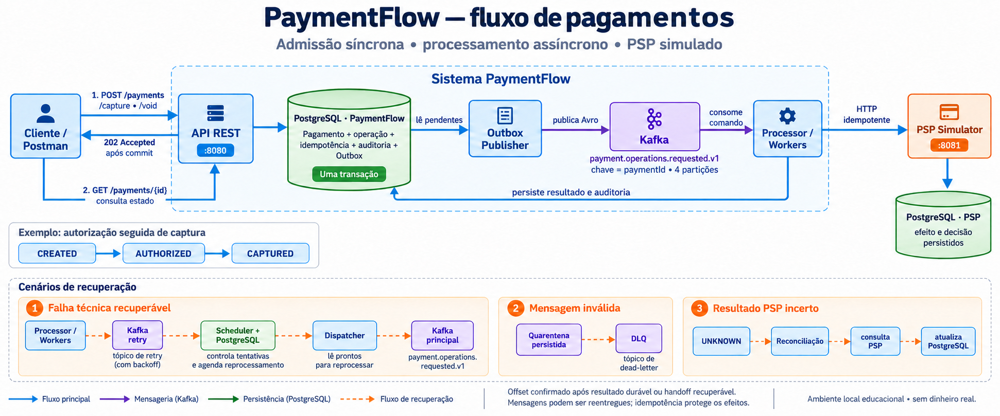

# PaymentFlow — fluxo do sistema

A API persiste a admissão e a Outbox na mesma transação antes de responder `202 Accepted`. O Publisher publica o comando no Kafka; o Processor chama o PSP e persiste o resultado. O cliente acompanha o estado pelo `GET /payments/{paymentId}`.

API, Publisher e Processor pertencem à mesma aplicação Java. Kafka e PostgreSQL são serviços externos. O PSP Simulator é outro processo Java, com banco separado. A região “Sistema PaymentFlow” representa componentes lógicos, não um único processo.

Na imagem, `/capture` e `/void` abreviam `/payments/{paymentId}/capture` e `/payments/{paymentId}/void`. A sequência de estados mostra um exemplo bem-sucedido; recusas, falhas e resultados incertos seguem outros caminhos.

Falhas técnicas recuperáveis usam retry persistido e dispatch posterior. Mensagens inválidas seguem para quarentena/DLQ. Resultados financeiros incertos ficam `UNKNOWN` e são reconciliados consultando o PSP. O backoff determina a elegibilidade no scheduler; o tópico Kafka não realiza a espera sozinho.

Schema Registry e detalhes de leases, offsets e auditoria foram omitidos visualmente para facilitar a leitura. Consulte os [contratos](../contracts/) e a [matriz de testes de recuperação](../testing/m6-failure-recovery.md) para as garantias completas.

Ilustração gerada com a ferramenta integrada `image_gen`. Direção do prompt: infográfico de system design em português, fundo claro, caixas e setas direcionais, fluxo principal API → PostgreSQL/Outbox → Publisher → Kafka → Processor → PSP, persistência do resultado e consulta GET; caminhos separados de retry, quarentena e reconciliação. Refinamento final: usar “Sistema PaymentFlow” na região que inclui serviços externos.
