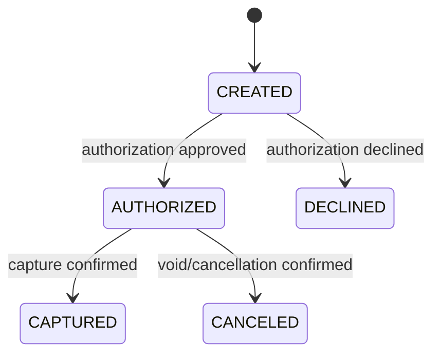
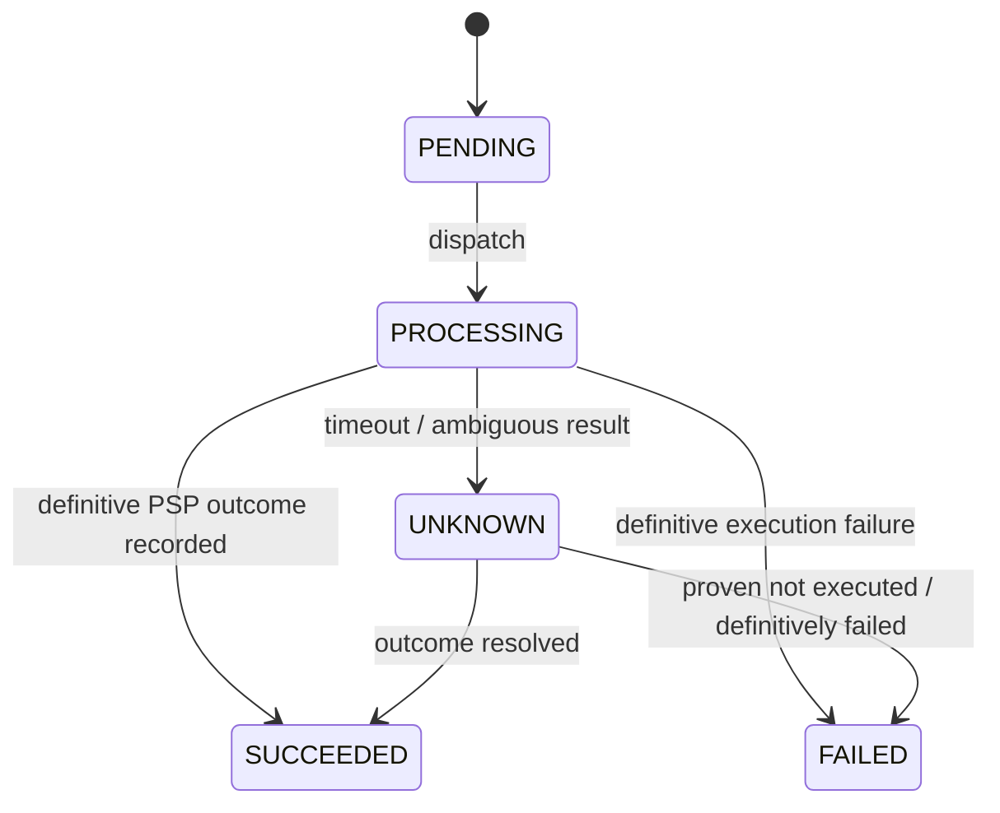

# Payment and Payment Operation — State Machines

- **Status:** Agreed domain baseline (2026-10-20)
- **Scope:** Payment lifecycle and external PSP operation lifecycle for the credit-card MVP
- **Architecture decision:** [ADR-0001 — Separate Payment from PaymentOperation](../adr/0001-separate-payment-and-payment-operations.md)
- **Related business rules:** [BR-001](../requirement/BR-001-idempotent-payment-requests.md), [BR-002](../requirement/BR-002-uncertain-psp-outcomes.md)

## Domain boundaries

Two separate concepts are required:

1. **Payment** represents the business/financial state of one logical payment.
2. **PaymentOperation** represents one identifiable financial action against the payment service provider (PSP), such as authorization, capture, or void/cancellation.

A single Payment can have different PaymentOperations over its lifecycle. Retries or redeliveries of the **same logical PSP action** must not silently create a second independent external financial operation.

`PaymentOperationStatus` is **an enum/value, not a third aggregate or service**.

## 1. PaymentStatus

Agreed MVP baseline:

```java
public enum PaymentStatus {
    CREATED,
    AUTHORIZED,
    CAPTURED,
    DECLINED,
    CANCELED
}
```

| Status | Business meaning |
| --- | --- |
| `CREATED` | The logical payment exists; no authorization outcome has yet been confirmed. **It does not mean no PSP request was sent**. |
| `AUTHORIZED` | The PSP has confirmed authorization; funds are not yet confirmed captured. |
| `CAPTURED` | The PSP has confirmed capture, but settlement is not implied. |
| `DECLINED` | The PSP definitively declined authorization. |
| `CANCELED` | Cancellation/void has been confirmed for an authorization before capture. |

### Agreed primary transitions



Only these **primary happy-path/business transitions** have been agreed. This is not yet a complete transition matrix for every failure, cancellation request, expiration, or future refund.

## 2. PaymentOperationType

```java
public enum PaymentOperationType {
    AUTHORIZE,
    CAPTURE,
    VOID
}
```

Each operation has its own identity and can be correlated with the PSP's operation reference/idempotency key.

## 3. PaymentOperationStatus

Agreed operation lifecycle baseline:

```java
public enum PaymentOperationStatus {
    PENDING,
    PROCESSING,
    SUCCEEDED,
    FAILED,
    UNKNOWN
}
```

| Status | Operational meaning |
| --- | --- |
| `PENDING` | The operation is registered/queued but not yet being executed. |
| `PROCESSING` | The PSP interaction is in progress; final outcome is not known. |
| `SUCCEEDED` | The operation has completed with a definitive PSP outcome that has been recorded. A successfully received **decline** response is not the same as an approved payment; see the distinction below. |
| `FAILED` | A definitive execution/technical failure has been established, not merely a timeout. Whether and how it can be retried is a separate decision. |
| `UNKNOWN` | The request may have executed at the PSP, but its outcome is not yet reliably known; investigation/reconciliation is needed. |

### Primary operation transitions (conceptual)



**Important:** `UNKNOWN -> FAILED` requires authoritative evidence. A timeout, absence of webhook, or exceeded retry budget by itself is **not** that evidence. Other retry/rollback transitions are deliberately left undefined.

## 4. Payment outcome is not transport execution outcome

A PSP can return a definitive **authorization declined** decision. In this initial split, that may be represented as:

- `PaymentStatus = DECLINED` (business result).
- `PaymentOperation(type=AUTHORIZE).status = SUCCEEDED` (the interaction completed and a definitive answer was recorded).
- The operation's **business decision / result** must remain distinguishable from its processing status; its concrete field/enum is **not yet designed**.

Conversely, an unresolved PSP request is represented on the **operation**, not by mutating the Payment to `PENDING_CONFIRMATION`.

### Examples

| Scenario | Payment status | Operation |
| --- | --- | --- |
| Payment created; authorization request not confirmed | `CREATED` | `AUTHORIZE: PENDING / PROCESSING / UNKNOWN` |
| Authorization confirmed | `AUTHORIZED` | `AUTHORIZE: SUCCEEDED` with approved outcome |
| Authorization declined | `DECLINED` | `AUTHORIZE: SUCCEEDED` with declined outcome |
| Capture request timed out after authorization | `AUTHORIZED` | `CAPTURE: UNKNOWN` |
| Capture confirmed | `CAPTURED` | `CAPTURE: SUCCEEDED` with captured outcome |
| Authorization void confirmed before capture | `CANCELED` | `VOID: SUCCEEDED` with canceled outcome |

### Why we do not store `PENDING_CONFIRMATION` on Payment

The same uncertainty can exist during **authorization** or **capture**. Changing Payment to one generic uncertain state would obscure the last confirmed business outcome.

Example:

```text
Payment #123
  status: AUTHORIZED

PaymentOperation #456
  payment_id: 123
  type: CAPTURE
  status: UNKNOWN
```

PaymentFlow knows authorization was confirmed, but **does not know** whether capture occurred. Its next action must reconcile operation #456 without triggering a new independent capture.

## 5. Invariants agreed so far

- Do not declare a financial result based solely on a network timeout.
- Do not treat Kafka redelivery, an HTTP retry, or a PSP callback replay as authorization to execute a new independent financial action.
- The Payment status must reflect **confirmed business facts**; unresolved PSP execution belongs to the PaymentOperation.
- Authorization and capture have **separate external operation identities** and separate idempotency boundaries.
- A Payment transition is applied only from an eligible, correlated and confirmed result; duplicated or out-of-order messages must not cause repeated side effects.

## 6. Still to decide (not approved yet)

- Exact transition matrix and which statuses are terminal for the MVP.
- Whether `PaymentStatus.FAILED` is needed for a terminal payment-level failure distinct from `DECLINED`; currently only `PaymentOperationStatus.FAILED` is defined.
- Whether to add `AUTHORIZING` / `CAPTURING` to Payment (current decision: represent work on PaymentOperation instead).
- Distinguishing an operation's processing status from PSP approval/decline result in a concrete model.
- Support for partial capture, multiple captures, void expiration, refunds, chargebacks, settlement, and reconciliation outside the initial scope.
- Conditional updates / optimistic locking / uniqueness guarantees, operation retries and webhook ordering.
- Precise implementation of consumer idempotency and message schema.

We will decide these items during later system-design steps rather than silently locking them into this document.
