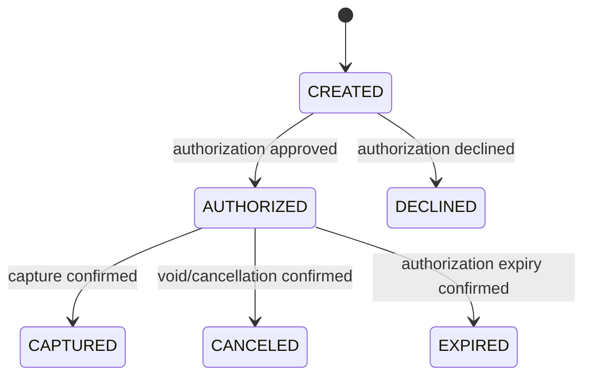
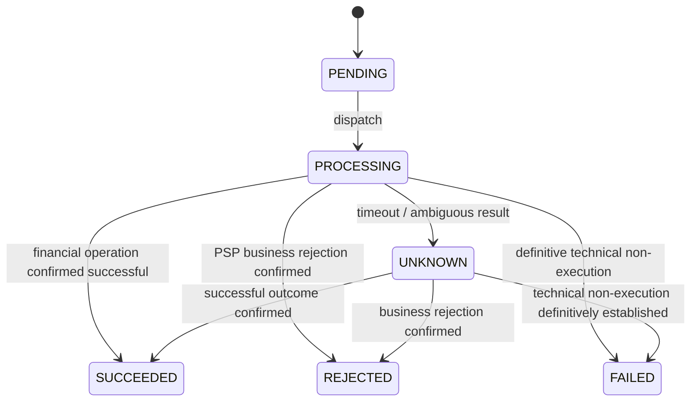

# Payment and Payment Operation — State Machines

- **Status:** Agreed domain baseline (2026-10-20)
- **Scope:** Payment lifecycle and external PSP operation lifecycle for the credit-card MVP
- **Architecture decision:** [ADR-0001 — Separate Payment from PaymentOperation](../adr/0001-separate-payment-and-payment-operations.md)
- **Related business rules:** [BR-001](../requirement/BR-001-idempotent-payment-requests.md), [BR-002](../requirement/BR-002-uncertain-psp-outcomes.md), [BR-003](../requirement/BR-003-expired-authorizations.md), [BR-004](../requirement/BR-004-idempotent-capture-requests.md), [BR-005](../requirement/BR-005-reconciliation-after-24h-unknown.md), [BR-006](../requirement/BR-006-distinguish-technical-failure-from-decline.md), [BR-007](../requirement/BR-007-bounded-psp-retries.md), [BR-008](../requirement/BR-008-block-conflicting-financial-operations.md)

## Domain boundaries

Two separate concepts are required:

1. **Payment** represents the business/financial state of one logical payment.
2. **PaymentOperation** represents one identifiable financial action against the payment service provider (PSP), such as authorization, capture, or void/cancellation.

A single Payment can have different PaymentOperations over its lifecycle. Retries or redeliveries of the **same logical PSP action** must not silently create a second independent external financial operation.

`PaymentOperationStatus` is **an enum/value, not a third aggregate or service**.

## 1. PaymentStatus

Agreed MVP baseline:

```java
public enum PaymentStatus {
    CREATED,
    AUTHORIZED,
    CAPTURED,
    DECLINED,
    CANCELED,
    EXPIRED
}
```

| Status | Business meaning |
| --- | --- |
| `CREATED` | The logical payment exists; no authorization outcome has yet been confirmed. **It does not mean no PSP request was sent**. |
| `AUTHORIZED` | The PSP has confirmed authorization; funds are not yet confirmed captured. |
| `CAPTURED` | The PSP has confirmed capture, but settlement is not implied. |
| `DECLINED` | The PSP definitively declined authorization. |
| `CANCELED` | Cancellation/void has been explicitly requested and confirmed for an authorization before capture. |
| `EXPIRED` | The authorization expired before capture, confirmed according to the PSP contract. Expiration is not an explicit void. |

### Agreed primary transitions



Only these **primary business transitions** have been agreed. This is not yet a complete transition matrix for every failure, cancellation request, expiry race, or future refund. Capture against a definitively expired authorization is blocked with proposed HTTP `409` / `AUTHORIZATION_EXPIRED` ([BR-003](../requirement/BR-003-expired-authorizations.md)).

## 2. PaymentOperationType

```java
public enum PaymentOperationType {
    AUTHORIZE,
    CAPTURE,
    VOID
}
```

Each operation has its own identity and can be correlated with the PSP's operation reference/idempotency key.

## 3. PaymentOperationStatus

Agreed operation lifecycle baseline:

```java
public enum PaymentOperationStatus {
    PENDING,
    PROCESSING,
    SUCCEEDED,
    REJECTED,
    FAILED,
    UNKNOWN
}
```

| Status | Operational meaning |
| --- | --- |
| `PENDING` | The operation is registered/queued but not yet being executed. |
| `PROCESSING` | The PSP interaction is in progress; final outcome is not known. |
| `SUCCEEDED` | The PSP confirmed the requested **financial operation succeeded** (e.g. authorization approved, capture completed). |
| `REJECTED` | The PSP definitively rejected the operation for a **business/domain reason**, such as a declined card authorization. |
| `FAILED` | A definitive execution/technical failure has been established, not merely a timeout. Whether and how it can be retried is a separate decision. |
| `UNKNOWN` | The request may have executed at the PSP, but its outcome is not yet reliably known; investigation/reconciliation is needed. |

### Primary operation transitions (conceptual)



**Important:** `UNKNOWN -> FAILED` requires authoritative evidence. A timeout, absence of webhook, or exceeded retry budget by itself is **not** that evidence. Other retry/rollback transitions are deliberately left undefined.

## 4. Financial outcome versus technical/uncertain execution

[ADR-0003](../adr/0003-distinguish-financial-success-from-rejection.md) refines the original operation-status design: **a definitive response is not automatically a successful financial operation**.

- An approved authorization is `Payment.status = AUTHORIZED` and `PaymentOperation(type=AUTHORIZE).status = SUCCEEDED`.
- A declined authorization is `Payment.status = DECLINED` and `PaymentOperation(type=AUTHORIZE).status = REJECTED`; `psp_result_code` preserves the specific reason (e.g., `INSUFFICIENT_FUNDS`).
- A definitive technical failure with reliable evidence of non-execution is `PaymentOperation.status = FAILED`; it does not imply the card was declined.
- A missing or ambiguous PSP answer remains `PaymentOperation.status = UNKNOWN`; it does not override the Payment's last confirmed state.

`REJECTED` is operation-generic, whereas `DECLINED` describes the Payment business result of an authorization rejection. The concrete PSP reason-code taxonomy is still open.

An unresolved PSP request is represented on the **operation**, not by mutating the Payment to `PENDING_CONFIRMATION`.

### Examples

| Scenario | Payment status | Operation |
| --- | --- | --- |
| Payment created; authorization request not confirmed | `CREATED` | `AUTHORIZE: PENDING / PROCESSING / UNKNOWN` |
| Authorization confirmed | `AUTHORIZED` | `AUTHORIZE: SUCCEEDED` with approved outcome |
| Authorization declined | `DECLINED` | `AUTHORIZE: REJECTED` (e.g., `INSUFFICIENT_FUNDS`) |
| Capture request timed out after authorization | `AUTHORIZED` | `CAPTURE: UNKNOWN` |
| Capture confirmed | `CAPTURED` | `CAPTURE: SUCCEEDED` with captured outcome |
| Authorization void confirmed before capture | `CANCELED` | `VOID: SUCCEEDED` with canceled outcome |
| Authorization expiry confirmed before capture | `EXPIRED` | No new capture operation is allowed; expiration is tracked as a business transition |
| Confirmed technical failure to authorize, no execution | `CREATED` | `AUTHORIZE: FAILED` |
| Capture already completed, replayed with same key | `CAPTURED` | Existing `CAPTURE: SUCCEEDED`; no duplicate PSP charge |

### Why we do not store `PENDING_CONFIRMATION` on Payment

The same uncertainty can exist during **authorization** or **capture**. Changing Payment to one generic uncertain state would obscure the last confirmed business outcome.

Example:

```text
Payment #123
  status: AUTHORIZED

PaymentOperation #456
  payment_id: 123
  type: CAPTURE
  status: UNKNOWN
```

PaymentFlow knows authorization was confirmed, but **does not know** whether capture occurred. Its next action must reconcile operation #456 without triggering a new independent capture.

## 5. Invariants agreed so far

- Do not declare a financial result based solely on a network timeout.
- Do not treat Kafka redelivery, an HTTP retry, or a PSP callback replay as authorization to execute a new independent financial action.
- The Payment status must reflect **confirmed business facts**; unresolved PSP execution belongs to the PaymentOperation.
- Authorization and capture have **separate external operation identities** and separate idempotency boundaries.
- A Payment transition is applied only from an eligible, correlated and confirmed result; duplicated or out-of-order messages must not cause repeated side effects.
- Confirmed expired authorizations are not capturable; expiration (`EXPIRED`) is distinct from explicit cancellation (`CANCELED`).
- Repeated capture with the same request identity resolves to the original capture; a new identity against `CAPTURED` must be rejected ([BR-004](../requirement/BR-004-idempotent-capture-requests.md)).
- Operations remaining `UNKNOWN` for 24 hours require reconciliation/escalation, **not** automatic cancellation/failure ([BR-005](../requirement/BR-005-reconciliation-after-24h-unknown.md)).
- A definitive card decline produces `AUTHORIZE: REJECTED` and `Payment: DECLINED`; a technical failure with proof of non-execution produces `FAILED` on the operation; a timeout alone is `UNKNOWN` ([BR-006](../requirement/BR-006-distinguish-technical-failure-from-decline.md), [ADR-0003](../adr/0003-distinguish-financial-success-from-rejection.md)).
- The PSP HTTP financial attempt policy is **3 total attempts** with **5s, 10s, 20s per-request timeouts**, and only safe, PSP-idempotent retries are permitted. Exhaustion without a definitive PSP outcome means `UNKNOWN`, not `FAILED` ([BR-007](../requirement/BR-007-bounded-psp-retries.md)).
- A previous unresolved operation blocks new **independent conflicting** financial operations; same-operation idempotent retry, safe status checks and reconciliation do not create new financial operations. No manual/API override is included in the MVP ([BR-008](../requirement/BR-008-block-conflicting-financial-operations.md)).

## 6. Still to decide (not approved yet)

- Exact transition matrix and which statuses are terminal for the MVP.
- Whether `PaymentStatus.FAILED` is needed for a terminal payment-level failure distinct from `DECLINED`; currently only `PaymentOperationStatus.FAILED` is defined.
- Whether to add `AUTHORIZING` / `CAPTURING` to Payment (current decision: represent work on PaymentOperation instead).
- Final PSP result/reason-code taxonomy (separate from the agreed `SUCCEEDED` / `REJECTED` / `FAILED` / `UNKNOWN` lifecycle states).
- Support for partial capture, multiple captures, refunds, chargebacks, and settlement outside the initial scope; exact expiration detection, timing, and reconciliation mechanics remain open.
- Physical implementation of conditional updates / optimistic locking / uniqueness guarantees, concrete HTTP retry scheduling and error classification, and webhook ordering. **The 5s/10s/20s per-request timeout schedule is already approved** under BR-007.
- Precise implementation of consumer idempotency and message schema.
- The conceptual four-table data model and approved order/payment cardinality are documented in [Relational Data Model](relational-data-model.md); physical constraints are not implemented.
- Audit trail and retention are now approved under [NFR-001](../requirement/NFR-001-transaction-traceability-and-retention.md) and [ADR-0002](../adr/0002-append-only-audit-and-retention.md): append-only durable audit records, 5-year financial/audit retention, 30-day logs, and 7-day Kafka message retention. **Schemas, purge mechanisms, retention clock and security controls remain to be designed.**

We will decide these items during later system-design steps rather than silently locking them into this document.
